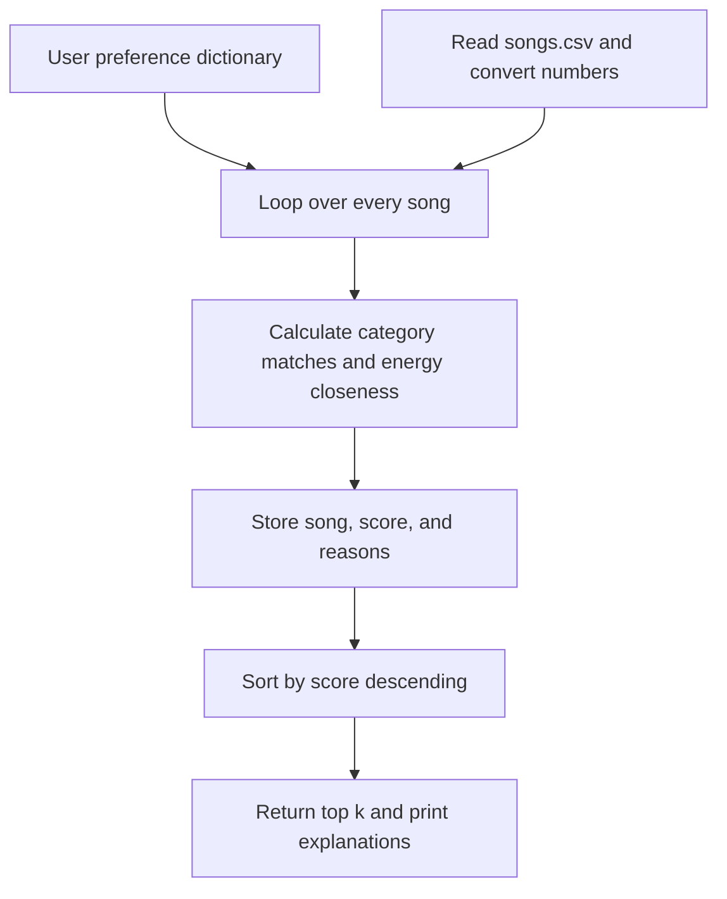

# 🎵 Music Recommender Simulation

## Project Summary

In this project you implements and explain a small music recommender system.

Your goal is to:

- Represent songs and a user "taste profile" as data
- Design a scoring rule that turns that data into recommendations
- Evaluate what your system gets right and wrong
- Reflect on how this mirrors real world AI recommenders

This project implements a small content-based music recommender using a catalog of 18 songs. It compares song attributes with a user taste profile, calculate a weighted relevance score, and rank songs to produce personalized suggestions with explanations. This is a classroom simulation with hand-written rules, not a trained model.

---

## How The System Works

Real-world recommendation systems can combine collaborative filtering and content-based filtering. Collaborative filtering uses patterns in listeners' behavior: users who enjoy similar songs may enjoy other songs in common. Content-based filtering compares item attributes with a listener's preferences. Likes, skips, repeated plays, and playlist additions provide behavioral signals; genre, mood, energy, and tempo describe the music. Our simulation uses content-based filtering and explicit preferences, prioritizing genre, mood, energy closeness, and an optional preference for acoustic music.

### Available data and feature choices

The CSV contains 10 songs, 11 columns, 7 genres, and 6 moods. Energy ranges from 0.28 to 0.93 and tempo from 60 to 152 BPM. Three songs are lofi and two are pop; every other genre has one song. This uneven, tiny catalog limits variety.

- `Song` stores `id`, `title`, `artist`, `genre`, `mood`, `energy`, `tempo_bpm`, `valence`, `danceability`, and `acousticness`.
- `UserProfile` stores `favorite_genre`, `favorite_mood`, `target_energy`, and `likes_acoustic`.
- The score uses genre, mood, energy, and acousticness. ID, title, and artist identify and display songs. Tempo, valence, and danceability remain available for later experiments; the starter profile has no corresponding preferences.

Genre and mood provide understandable category matches. Energy captures intensity, while acousticness can distinguish acoustic and electronic textures. Valence describes musical positivity and danceability describes suitability for dancing; neither alone captures a person's entire musical "vibe." Whether these labels reflect the student's own listening experience remains a personal reflection to add after trying recommendations.

### Final Algorithm Recipe

This Phase 2 design is implemented by the shared scoring function in Phase 3.

- Genre match: 2 points for the preferred genre, otherwise 0.
- Mood match: 1.5 points for the preferred mood, otherwise 0.
- Energy closeness: `1 - abs(song.energy - user.target_energy)`, worth up to 1 point for values between 0 and 1.
- Acoustic preference: add up to `0.5 * song.acousticness` when `likes_acoustic` is true. Otherwise add no acoustic bonus; false means no acoustic preference.

The score is the sum of these contributions. Genre has the strongest individual weight, followed by mood. For target energy 0.8, energy 0.75 earns 0.95 points, while energy 0.2 earns 0.4 points. This rewards closeness rather than always favoring higher energy.

A **scoring rule** evaluates one song against a profile. A **ranking rule** compares all scored songs, sorts them from highest to lowest, and returns the top `k`. We need both because individual scores alone do not select a recommendation list. Equal scores will preserve catalog order for reproducibility; that choice can favor earlier rows and should be revisited if ties are common.

```text
Song catalog + UserProfile -> Score each song -> Sort scores -> Top k + explanations
```

---

## Getting Started

### Setup

1. Create a virtual environment (optional but recommended):

   ```bash
   python -m venv .venv
   source .venv/bin/activate      # Mac or Linux
   .venv\Scripts\activate         # Windows
   ```

2. Install dependencies

```bash
python -m pip install --upgrade pip
python -m pip install -r requirements.txt
```

3. Run the app:

```bash
python -m src.main
```

### Running Tests

Run the starter tests with:

```bash
python -m pytest -q
```

You can add more tests in `tests/test_recommender.py`.

---

## Sample Recommendation Output

Actual terminal output from `python -m src.main`:

```text
Loaded songs: 18
Weights: genre=2.0, mood=1.5, energy=1.0

User profile: High-Energy Pop
Preferences: {'favorite_genre': 'pop', 'favorite_mood': 'happy', 'target_energy': 0.8, 'likes_acoustic': False}
Top recommendations:
1. Sunrise City — Neon Echo | Score: 4.48
   Because: genre match (+2.00); mood match (+1.50); energy closeness (+0.98; song 0.82, target 0.80)
2. Gym Hero — Max Pulse | Score: 2.87
   Because: genre match (+2.00); energy closeness (+0.87; song 0.93, target 0.80)
3. Rooftop Lights — Indigo Parade | Score: 2.46
   Because: mood match (+1.50); energy closeness (+0.96; song 0.76, target 0.80)
4. Concrete Resolve — Verse Atlas | Score: 0.95
   Because: energy closeness (+0.95; song 0.85, target 0.80)
5. Night Drive Loop — Neon Echo | Score: 0.95
   Because: energy closeness (+0.95; song 0.75, target 0.80)
```

---

## Experiments You Tried

Run all five profiles with `python -m src.main --evaluate`. Run the weight-shift experiment with `python -m src.main --evaluate --experiment`: genre changes from 2 to 1 and energy from 1 to 2, while mood remains 1.5. Both configurations were executed; the default remains the original design. See the Model Card for every profile's output, all pairwise comparisons, and interpretation. These are changes in ranking, not measured improvements in listener satisfaction.

---

## Limitations and Risks

The catalog is tiny and includes eight AI-generated fictional additions. Exact genre matches overlook related genres, strong category weights can form filter bubbles, and the score ignores lyrics, listening history, and changing preferences. Scores express rule-based relevance, not probabilities or measured satisfaction. See the Model Card for experiment-backed limitations.

---

## Reflection

Read and complete `model_card.md`:

[**Model Card**](model_card.md)

Technical reflection: this simulation demonstrates how structured song data and explicit preferences become scores and then a ranked list. Changing feature weights changes which tradeoffs the program makes, even when the underlying song data stays the same.

The genre-weight experiment shows how a design decision can restrict discovery. Reducing genre weight moves a happy indie-pop song above an intense pop song for the happy-pop profile, but without listener feedback we cannot say that the new order is more accurate.

**Personal reflection pending:** the student should describe whether these recommendations fit their own musical intuition and what they personally learned. The AI has not listened to these fictional tracks or supplied personal experiences on the student's behalf.

## Phase 2 Design Record

### Step 1: Expanded data

Design prompt: "Generate eight fictional songs in valid CSV using every existing header. Use unique IDs 11–18 and genres and moods absent from the original catalog; keep normalized attributes between 0 and 1 and tempo positive."

Added folk/nostalgic, blues/sad, salsa/celebratory, classical/serene, hip hop/confident, rnb/romantic, metal/angry, and reggae/hopeful. Original rows and headers are preserved. All additions are synthetic examples, not measured audio features. Danceability and acousticness were already present, so no duplicate numerical columns were added. The expanded catalog has 18 songs, 15 genres, and 14 moods. Original-catalog statistics above describe the initial ten rows.

### Step 2: Specific taste profile and critique

```python
user_prefs = {
    "favorite_genre": "pop",
    "favorite_mood": "happy",
    "target_energy": 0.8,
    "likes_acoustic": False,
}
```

Critique prompt: "Can this profile structure distinguish intense rock from chill lofi, and where is it too narrow?"

Genre, mood, and target energy distinguish those two examples, as the evaluation demonstrates. However, one favorite genre and mood cannot capture someone who likes several styles or whose preferences change with context. The acoustic flag adds one texture preference but false means neutral, not a dislike. Future versions could accept multiple genres, an energy range, and context-specific profiles.

### Step 3: Scoring Logic Design

Design prompt: "Using songs.csv, compare genre and mood weighting strategies and propose a closeness score for energy. Keep each contribution explainable and avoid treating high energy as always better."

The finalized recipe above uses genre 2, mood 1.5, energy closeness up to 1, and an optional acoustic bonus up to 0.5. Mood is stronger than the suggested 1-point baseline to give it more influence, while genre remains the largest individual contribution. A mood-first system could reverse the category weights; the evaluation instead tests the specified genre/energy shift. The screenshot requests a separate chat session for this discussion: this design was completed in the current chat, not a separate session.

### Step 4: Data-flow sketch



### Step 5: Plan and anticipated bias

The complete plan is in this README's How The System Works section and design record. A strong genre bonus can hide music that matches the mood but has another genre label. Uneven representation and catalog-order ties can favor certain songs. The fixed energy-distance rule assumes equal differences represent equal differences in taste, which may not hold for listeners.

## Phase 3 Implementation Notes

`load_songs` uses Python's `csv.DictReader`, converts IDs to integers and musical numbers to floats, and validates ranges. `score_song` returns a number plus a list of contribution reasons. `recommend_songs` scores every row and returns `(song, score, explanation)` tuples. Object-based calls reuse the same logic.

Python's `list.sort()` changes a list in place and returns `None`. `sorted()` creates a new sorted list; we use it to preserve the catalog's original order. Sorting is stable, so exact-score ties retain their input order. Displayed scores are rounded to two decimals; ranking uses full precision, so nearly equal numbers that display identically need not be exact ties.

## Completion and student-owned steps

- Completed here: dependency setup, dataset review and expansion, design, implementation, explanations, CLI runs, five-profile evaluation, weight experiment, automated checks, and documentation.
- Separate-chat design/evaluation discussions were carried out in this chat; no separate chat sessions were opened.
- Personal musical intuition, reflection, and manual review must come from the student. No personal reactions have been fabricated.
- Phases 1–5 and all four optional extensions shown in the screenshots have been reviewed. The linked detailed grading page was not supplied.

## Optional Extensions: Run and Design

```bash
python -m src.main --mode mood-first
python -m src.main --mode energy-focused
python -m src.main --advanced
python -m src.main --diversity
python -m src.main --advanced --mode mood-first --diversity --table
```

All four shown challenges are implemented. Five extra attributes are present in every CSV row and participate when `--advanced` supplies explicit preference targets. `--mode` selects a configuration-based Strategy. `--diversity` applies a greedy artist/genre repetition penalty. `--table` prints song names, scores, and wrapped reasons using Python formatting without another dependency. See the Model Card for formulas, caveats, and actual table output, and `ai_interactions.md` for design and verification notes.

Final checks: 18 automated tests passed, dependency consistency passed, and 12 CLI configurations ran across five profiles (60 profile runs). The default scoring output remains unchanged by opt-in extensions.

## Submission Checklist

- Correct repository: `momunalieva/ai110-module3show-musicrecommendersimulation-starter`.
- Required code, README, Model Card, tests, data, and stretch-feature log are present.
- Implementation and extension/documentation work are recorded in meaningful commits.
- Public visibility: not verified; the environment blocked the GitHub API request. Check the Public label on GitHub. No visibility changes were made.
- Reflection: a simple draft is in Model Card section 9. Review it and supply your own honest learning and musical observations before submission.
- Commit/push status is reported in chat after the final push; a local commit alone is not proof of remote persistence.
- Deadline: not provided, so on-time submission cannot be verified.
- Submit using the course page's Submit button after reviewing the repository. The assistant has not submitted the assignment.
